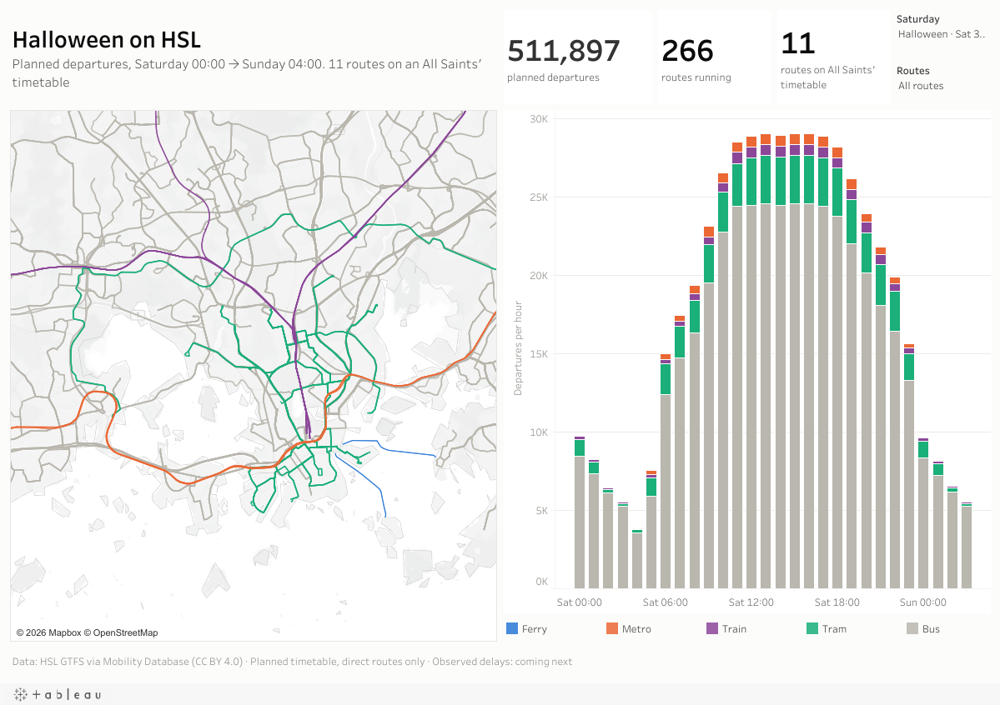
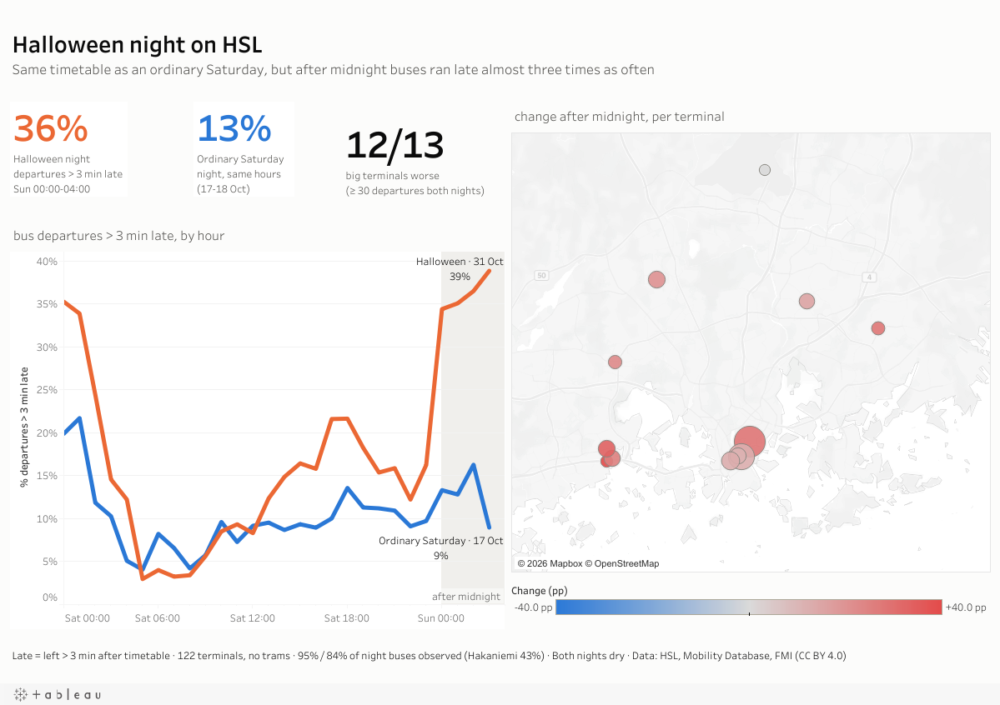
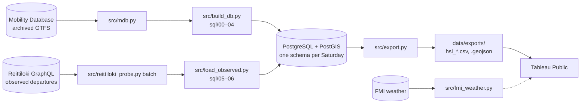

# Halloween on HSL: planned vs observed transit in Helsinki

A data-analysis portfolio project. It compares Helsinki's public transport (HSL) on Halloween night, Saturday 31 October 2026, with an ordinary Saturday two weeks earlier, and answers one question:

> **Was Halloween night less reliable than an ordinary Saturday night, beyond what the timetable planned?**

| Deliverable | Where |
|---|---|
| **Tableau Public dashboards** (two tabs: the timetable, then Halloween night) | [Live dashboards](https://public.tableau.com/app/profile/triet.le3679/viz/hsl/Plannedservices) · [`tableau/hsl.twb`](tableau/hsl.twb) |
| **Pipeline** (Python stdlib + PostgreSQL/PostGIS SQL) | `src/`, `sql/` |
| **Checks behind every headline number** | [`sql/analysis/checks.sql`](sql/analysis/checks.sql) |

## Key findings

Study window: Saturday 00:00 → Sunday 04:00 (28 hours), Halloween (31 Oct) vs an ordinary Saturday (17 Oct).

1. **The timetable barely changed.** 511,897 planned departures on Halloween vs 511,709 on the ordinary Saturday (+0.04%). Only 22 of 266 routes differ. All Saints' Day (also 31 Oct) moved 11 routes to a holiday timetable, but 8 of those 11 kept identical trip counts.
2. **But after midnight, buses ran late almost three times as often.** 36% of bus departures from terminals left more than 3 minutes late between Sun 00:00 and 04:00, vs 13% on the ordinary night. The median delay rose by 60–100 seconds.
3. **It wasn't one or two places.** 12 of the 13 big terminals (≥ 30 night departures on both nights) were worse, 11 of them by more than 5 percentage points. Without the two busiest (Rautatientori and Hakaniemi), it's still 23% vs 9%.
4. **It built up over the evening.** Daytime was close (11% vs 8% late), the evening was worse (17% vs 11%), and it jumped at midnight. The night before Halloween (Fri 30 Oct) was rough too: 23% vs 14% in Saturday's early hours.
5. **Weather doesn't explain it.** Both nights were dry (0.0 mm). Halloween night was the milder and calmer of the two (FMI observations).

These describe one night against one ordinary night: "on this night", not "Halloween causes". The limits are listed [below](#limits).

## Screenshots

**The timetable.** Planned departures per hour by mode, with a route map. Switch between the two Saturdays: they look the same.



**Halloween night.** Share of bus departures more than 3 minutes late by hour, and the change after midnight at each terminal. Click a terminal to filter the numbers and the line.



## How it works



Each Saturday gets its own Postgres schema (`halloween`, `baseline`) built from the GTFS snapshot that was live at the time. The same SQL runs in both, so the two are directly comparable.

**Method, in short**

- **Three service days per window.** HSL's service day runs about 04:30 → 04:30, so Sat 00:00 → Sun 04:00 needs Friday's late trips, Saturday and Sunday's earliest. GTFS times past 24:00 become real timestamps.
- **Planned = GTFS, observed = Reittiloki.** Each observed departure is matched to its planned GTFS departure on terminal + route + direction + planned time. Match rate: 98.6% (Halloween) and 96.9% (ordinary). The unmatched rows are explained: U-line buses that aren't in HSL's GTFS, arrival-only terminal stops, and one platform move at Hakaniemi.
- **One row per planned departure.** Reittiloki lists a departure once for each vehicle seen on it. The pipeline keeps one, preferring an observed vehicle.
- **Late = left more than 3 minutes after the timetable**, measured by Reittiloki against its own planned time. Percentages are computed from counts (late ÷ observed), never by averaging percentages.
- **Cancellations:** most of Reittiloki's `isCancelled` flags are `TIS_ERROR` data errors. Only other cancellation types count as real.
- **Bus only on the reliability dashboard.** The metro doesn't run after midnight, there are no tram terminals, and train terminals have too few night departures to compare.

## Reproduce it

Needs Python 3.13 (built and tested on it; the code is stdlib plus `psycopg`), Docker and a free [Mobility Database](https://mobilitydatabase.org) account (for the GTFS archive). Everything else is public with no key.

```bash
git clone https://github.com/trietle145/hsl-halloween-night.git
cd hsl-halloween-night
python -m venv .venv && .venv/Scripts/activate   # macOS/Linux: source .venv/bin/activate
pip install -r requirements.txt
cp .env.example .env                             # add your MDB_REFRESH_TOKEN, pick a Postgres password
docker compose up -d                             # Postgres 17 + PostGIS on 127.0.0.1:5432
```

Then the pipeline, in order:

```bash
# 1. planned service: GTFS snapshots -> one schema per Saturday
python src/mdb.py 2026-10-30 2026-10-31 2026-11-01 2026-10-16 2026-10-17
python src/build_db.py data/raw/gtfs/mdb-865-202611010130.zip halloween
python src/build_db.py data/raw/gtfs/mdb-865-202610180116.zip baseline

# 2. observed service: 122 terminals x 4 service dates (~20 min, cached, 1 request/s)
python src/reittiloki_probe.py batch data/raw/gtfs/mdb-865-202611010130.zip 2026-10-16 2026-10-17 2026-10-30 2026-10-31
python src/load_observed.py

# 3. files for Tableau
python src/export.py

# optional: weather context and the checks behind the findings
python src/fmi_weather.py
docker compose exec -T db psql -U hsl -d hsl -f - < sql/analysis/checks.sql
```

Expected results: 511,897 / 511,709 planned departures, and 35.9% / 13.0% of night buses late. Building one GTFS schema takes about 10 minutes.

**Two things to know:**
- **Reittiloki keeps data for about four months.** The October 2026 observations can't be re-downloaded after about mid-February 2027. That's why the exports in `data/exports/` are committed: the dashboards and their numbers survive even when step 2 no longer can.
- **Opening the workbook:** `tableau/hsl.twb` reads `data/exports/`. If Tableau can't find the files after a fresh clone, point each data source at your copy (Data → Edit Data Source). The published version on Tableau Public has its data embedded.

## Data sources

| Source | Used for | Terms |
|---|---|---|
| [Mobility Database](https://mobilitydatabase.org) (feed `mdb-865`) | Archived HSL GTFS: the timetable that was live on each Saturday (snapshots `mdb-865-202611010130`, `mdb-865-202610180116`) | Free account. GTFS data © HSL, CC BY 4.0 |
| [Reittiloki](https://reittiloki.hsl.fi) (HSL transitlog) | Observed departures and cancellations at all 122 terminals | Public GraphQL, no key. No terms specific to scripted use found, so pulls were sequential, cached and about 1 request per second. HSL data, CC BY 4.0 |
| [FMI open data](https://en.ilmatieteenlaitos.fi/open-data) | Hourly weather at Helsinki Kaisaniemi and Helsinki-Vantaa | Public WFS, no key. CC BY 4.0 |

Data credit: HSL (Helsinki Regional Transport Authority), Mobility Database, Finnish Meteorological Institute.

## Limits

- **Terminals only.** Reittiloki was pulled for HSL's 122 terminals, which hold about 8.5% of all departures. Trams and most mid-route stops aren't covered, so the result describes buses leaving terminals.
- **One night each.** One Halloween against one ordinary Saturday. It shows what happened on this night, not a general Halloween effect.
- **Coverage.** 95% of night bus departures were observed on Halloween and 84% on the ordinary night. The gap is almost all Hakaniemi (43% observed on the ordinary night). The network-wide result holds without Hakaniemi.
- **No transfers or journey times.** Departures only, from the timetable's point of view.

## Repo layout

```
├── src/               Python entry points: GTFS download, DB build, Reittiloki pull, loader, exports, weather
├── sql/               00–04 planned service (per schema), 05–06 observed + reliability, analysis/checks.sql
├── data/raw/          downloads, git-ignored (GTFS zips, Reittiloki JSON, FMI XML)
├── data/exports/      Tableau-ready CSV / GeoJSON (committed)
├── tableau/           hsl.twb workbook and dashboard screenshots
├── compose.yaml       Postgres 17 + PostGIS
└── .env.example       settings to copy into .env
```
